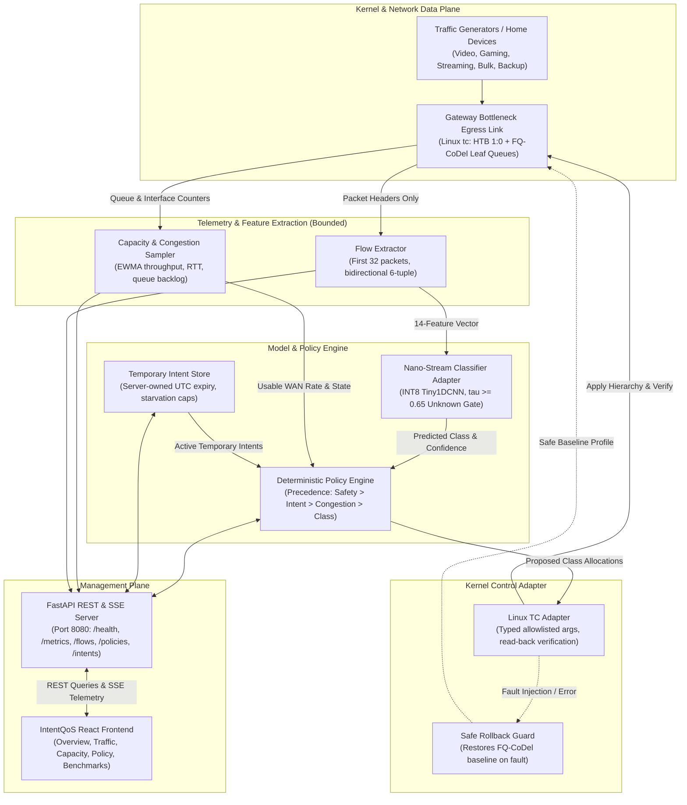
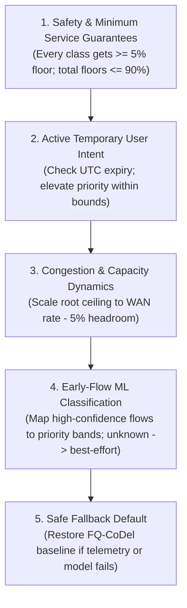

# IntentQoS System Architecture & Technical Specification

**Project:** IntentQoS — Adaptive QoS Engine for Mixed Home Broadband Traffic  
**Research Foundation:** Nano-Stream (IEEE Xplore 11504604)  
**Date:** 30 October 2026  
**Document Status:** Approved Reference Architecture  

---

## 1. High-Level Architecture Overview

IntentQoS is a privacy-preserving, resource-conscious, closed-loop Quality of Service (QoS) reference platform designed for residential broadband gateways. It combines:

1. **Early-flow header metadata classification** using a lightweight, INT8-quantized 1D-CNN (Nano-Stream architecture).
2. **Deterministic, explainable policy adaptation** driven by real-time bottleneck capacity and queue delay measurements.
3. **Temporary, server-enforced user intents** (e.g. prioritizing an urgent work conference call for 30 minutes).
4. **Inspectable kernel-level enforcement** using Linux Traffic Control (`tc`) with Hierarchical Token Bucket (HTB) shaping and Fair Queueing Controlled Delay (FQ-CoDel) leaf queueing.



---

## 2. Process Boundaries & Separation of Concerns

| Process / Component | Execution Context | Privilege Level | Primary Responsibility |
|---|---|---|---|
| **Kernel Data Plane (`tc`)** | Linux Kernel space | Kernel | High-speed packet scheduling, shaping, and queue management via HTB and FQ-CoDel. |
| **Flow Extractor** | Python Daemon / Service | Low (or packet capture) | Tracks first 32 packet headers, computes 14-feature vector, prunes idle flows ($< 30\,\text{s}$). |
| **Model Loader & Inference** | Python (`torch.jit`) | Unprivileged | Sub-millisecond CPU inference ($18\,\mu\text{s}$) with confidence gate ($\tau = 0.65$). |
| **Capacity Sampler** | Python Daemon | Unprivileged | Computes EWMA throughput, detects queue delay spikes, and manages adaptation cooldowns. |
| **Policy Engine & Intent Store** | Python Daemon | Unprivileged | Pure deterministic rule engine evaluating priority precedence and absolute intent deadlines. |
| **Linux TC Adapter** | Helper subprocess | `CAP_NET_ADMIN` / Root | Typed execution of `tc` commands and read-back verification (`tc -s class show`). |
| **Management API** | FastAPI / Uvicorn | Unprivileged (Port 8080) | REST contract endpoints and SSE live streams. Completely decoupled from packet path. |
| **React Frontend Shell** | Browser / Vite / Node | Client / User | Accepts user intent, displays live metrics, graphs, and handles offline DEMO playback. |

---

## 3. Policy Precedence & Adaptation Logic

When evaluating network state, the Policy Engine strictly follows this priority hierarchy:



---

## 4. Linux `tc` Hierarchical Token Bucket (HTB) Structure

```text
                           qdisc htb 1:0 default 1:40
                                        |
                                 class htb 1:1
                            rate $WAN_RATE ceil $WAN_RATE
                                        |
        +---------------+---------------+---------------+---------------+---------------+
        |               |               |               |               |               |
    class 1:10      class 1:20      class 1:30      class 1:40      class 1:50      ...
   (Video Calls)     (Gaming)       (Streaming)    (Browsing/Unk)     (Bulk/Sync)
      prio 1          prio 2          prio 3          prio 4          prio 5
    floor: 15%      floor: 10%      floor: 30%      floor: 20%      floor: 10%
    ceil: 100%      ceil: 100%      ceil: 90%       ceil: 90%       ceil: 60%
        |               |               |               |               |
     fq_codel        fq_codel        fq_codel        fq_codel        fq_codel
```
