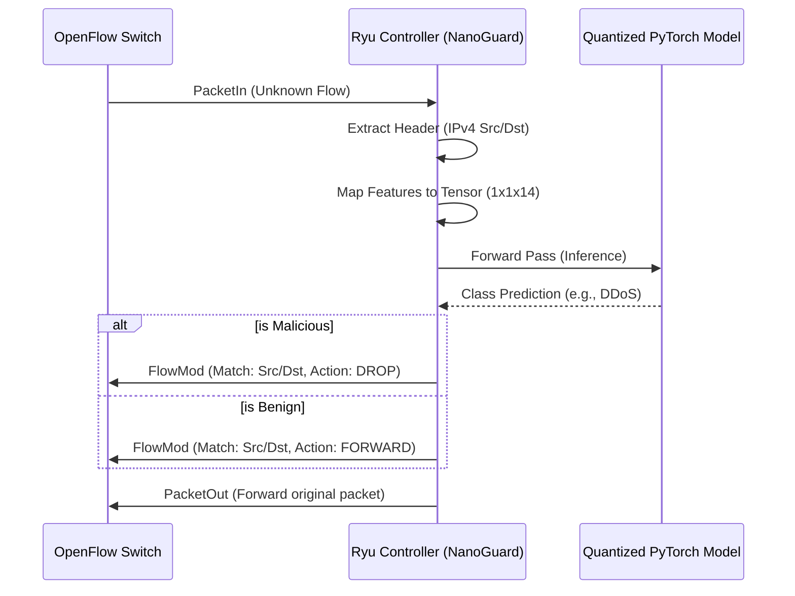

# Architectural Blueprint: AI-Driven Traffic Classification & SDN Enforcement

This document outlines the end-to-end architecture of the Traffic Classification system, spanning from offline deep learning training to real-time software-defined networking (SDN) mitigation.

## 1. System Overview & Component Roles

The system is partitioned into two main planes: the **Training Plane** (Offline) and the **Control/Enforcement Plane** (Real-time).

| Component | File Path | Role | Core Purpose |
| :--- | :--- | :--- | :--- |
| **Orchestrator** | [`train.py`](../train.py) | Training | Manages the ML lifecycle: data loading, label encoding, and model optimization. |
| **Model Engine** | [`models/tiny_1d_cnn.py`](../models/tiny_1d_cnn.py) | AI Architecture | Defines a compact 1D Convolutional Neural Network optimized for network flow features. |
| **Feature Schema** | [`features.json`](../features.json) | Data Definition | Strictly defines the 14 flow-level metrics used as input for the model. |
| **SDN Controller** | [`ryu_app/nano_guard.py`](../ryu_app/nano_guard.py) | Control Plane | A Ryu application that bridges AI inference with OpenFlow rule enforcement. |

---

## 2. ML Training Pipeline & Model Evolution

### Data Ingestion
The pipeline ingests slices of the **CICIDS2017** dataset. Raw PCAP-derived CSVs are processed into 14 key features (e.g., `flow_duration`, `pkt_rate`, `tcp_flag_count_SYN`). Labels are encoded into integers using `LabelEncoder`, mapping classes like `BENIGN`, `DDoS`, and `Bot` to a categorical vector.

### Model Architecture: Tiny 1D CNN
The [`Tiny1DCNN`](../models/tiny_1d_cnn.py) is designed for low-latency inference:
1.  **Input**: `(Batch, 1, 14)` tensor.
2.  **Feature Extraction**: Two `Conv1d` layers with 8 and 16 filters respectively, extracting local temporal/spatial correlations between adjacent features.
3.  **Dimensionality Reduction**: `MaxPool1d` and `AdaptiveAvgPool1d` (Global Average Pooling) to minimize parameter count and provide spatial invariance.
4.  **Classification**: Two fully connected layers with Dropout (0.2) to prevent overfitting.

### Checkpoint Hierarchy
The system generates three distinct types of model artifacts in the [`checkpoints/`](../checkpoints/) folder:

1.  **[`float.pt`](../checkpoints/float.pt) (Eager FP32)**:
    *   *Nature*: Standard PyTorch state dictionary.
    *   *Usage*: Used for resuming training or standard Python-based evaluation. Requires the original Python class definition to load.
2.  **[`float_scripted.pt`](../checkpoints/float_scripted.pt) (TorchScript)**:
    *   *Nature*: Compiled model via `torch.jit.trace`.
    *   *Usage*: Serializes the computational graph. It can be loaded in environments without the Python source code, providing a slight performance boost.
3.  **[`quantized.pt`](../checkpoints/quantized.pt) (Dynamic INT8)**:
    *   *Nature*: Weights of Linear layers are quantized from 32-bit floats to 8-bit integers.
    *   *Usage*: **Primary deployment artifact.** Reduces model size by ~4x and significantly speeds up CPU-bound inference in the Ryu controller.

---

## 3. Real-Time SDN Integration & Inference Flow

The real-time loop follows the **Reactive SDN Pattern**:

### Inference Step Details
1.  **Interception**: `nano_guard.py` listens for `EventOFPPacketIn`.
2.  **Feature Mapping**: The controller extracts metrics corresponding to [`features.json`](../features.json). *Note: Currently, extraction logic uses a placeholder; production requires a flow-state tracker.*
3.  **Inference**: The `input_tensor` is passed to `self.model`, which is the `quantized.pt` TorchScript artifact.
4.  **Latency**: Quantization ensures inference typically completes in sub-millisecond timeframes, minimizing the "first-packet delay".

---

## 4. TCAM Evaluation & Scaling Strategy

### Critical Evaluation: Current Per-Flow Caching
The current implementation of `nano_guard.py` installs rules using:
`match = parser.OFPMatch(eth_type=0x0800, ipv4_src=ip_pkt.src, ipv4_dst=ip_pkt.dst)`

*   **Risk**: **TCAM Exhaustion**. Hardware switches have limited Ternary Content-Addressable Memory (TCAM). Installing a unique rule for every `(src, dst)` pair results in $O(N)$ memory growth. In a DDoS attack with spoofed IPs, the TCAM will overflow in seconds, forcing the switch to default to the controller and causing a Control Plane saturation (DoS on the controller itself).

### Roadmap for Scalable Enforcement
To achieve $O(1)$ or sub-linear scaling, we propose a transition to **Proactive Aggregation**:

1.  **Derivative-based Phase Detector**:
    *   Instead of waiting for every flow, the controller monitors the *rate of change* in flow arrivals. When a specific entropy threshold is crossed, it triggers a "Defensive Phase."
2.  **Bloom-union Synthesis**:
    *   Instead of 1,000 DROP rules for 1,000 IPs, we can synthesize a compact set of prefix-based rules (e.g., `/24` or `/16`) that encompass the majority of the attack surface while minimizing false positives.
3.  **Wildcard Matching**:
    *   Moving from exact matches to wildcarded IP masks based on AI-identified attack clusters.

---
*Blueprint generated by Roo (Senior Network & AI Architect)*
